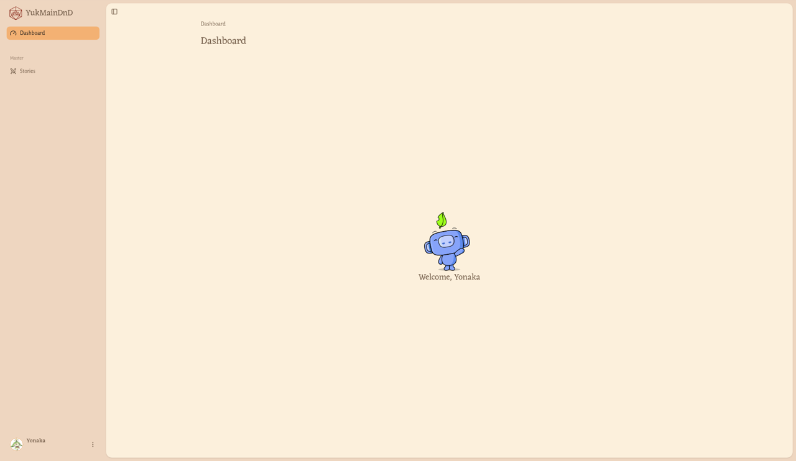

# Ikhtisar untuk Dungeon Master

Bagian ini untuk kamu yang menjalankan Story sebagai **Dungeon Master** (DM). Sebagai DM, kamu bisa membuat Story baru, menerbitkannya di papan Story, mengatur anggota party, lalu menyelesaikannya dan membagikan hadiah.

## Masuk sebagai Dungeon Master

1. Masuk ke akunmu. Lihat [Mulai di sini](../getting-started.md#masuk-ke-akun).
2. Pastikan role yang aktif adalah **Dungeon Master**. Kalau belum, buka menu avatar, pilih **Switch Role**, lalu pilih role itu. Lihat [Memilih role](../pemain/ganti-role.md).
3. Klik **Dashboard** di bilah atas.

## Menu samping untuk Dungeon Master

Dengan role Dungeon Master, menu samping Dashboard berisi:

- logo **YukMainDnD** (kembali ke Beranda),
- **Dashboard**: halaman sambutan bertuliskan "Welcome, (namamu)",
- kelompok **Master** dengan satu menu: **Stories**, tempat kamu mengelola Story,
- kartu nama di bagian bawah untuk membuka menu avatar.

> **Perlu kamu tahu:** Kelompok **Board** (halaman **My Stories**, **Events**, **Goods**) tidak tampil saat role Dungeon Master aktif. Untuk melihat Story yang kamu ikuti sebagai pemain, ganti dulu ke role Player.

## Halaman di bagian ini

- [Mengelola Story (Stories)](story.md)

## Pola yang sama di halaman Stories

- Pencarian: ketik minimal 3 karakter di kolom **Type minimum 3 characters to search ...**. Kosongkan kolom untuk menampilkan semuanya lagi.
- Saringan dan urutan: klik **Filter**, atur pilihannya, lalu klik **Apply**. Klik **Clear** untuk kembali ke pengaturan awal.
- Daftar **Stories** awalnya hanya menampilkan Story milikmu. Untuk melihat Story semua penulis, kosongkan **Created By** di **Filter**, lalu klik **Apply**. Lihat [Melihat Story semua penulis](story.md#melihat-story-semua-penulis).
- Pindah halaman: di bawah daftar ada tulisan seperti "1 - 2 of 2 items", tombol nomor halaman, dan pilihan jumlah per halaman (misalnya **12 / page**).
- Konfirmasi: aksi penting seperti menerbitkan atau menghapus selalu meminta konfirmasi dulu. Klik **Cancel** untuk batal.
- Pesan: setiap aksi menampilkan pesan singkat di layar, misalnya **Story created**.
- Tombol aksi hanya muncul kalau aksinya tersedia untukmu. Untuk Story yang ditulis DM lain, biasanya kamu hanya bisa melihatnya (**View**).
