# Mengelola Story (Stories)

Halaman ini untuk Dungeon Master yang membuat, menerbitkan, dan menyelesaikan Story.

> **Story milikmu vs. milik DM lain.** Daftar Stories awalnya hanya menampilkan Story yang kamu tulis. Kamu juga bisa menampilkan Story yang ditulis DM lain (lihat [Melihat Story semua penulis](#melihat-story-semua-penulis)), tapi untuk Story itu kamu hanya bisa membukanya (**View**). Tombol untuk mengubah, menerbitkan, menyelesaikan, membatalkan, mengarsipkan, menghapus, dan mengatur anggota hanya muncul di Story yang kamu tulis sendiri.

## Perjalanan sebuah Story

Setiap Story punya status:

| Status | Artinya |
| --- | --- |
| **Draft** | Masih disiapkan, belum tampil di papan Story publik |
| **Published** | Sudah terbit dan menerima anggota (di papan publik tampil sebagai **Recruiting**) |
| **Completed** | Sudah selesai; peserta yang hadir sudah dihadiahi. Tidak bisa diubah lagi. |
| **Cancelled** | Dibatalkan. Tidak bisa dibatalkan balik, tidak bisa diubah, dan anggotanya tidak bisa ditambah atau dikurangi. |
| **Archived** | Disimpan di arsip. Bisa dikembalikan ke status sebelumnya (**Draft** atau **Published**). |

Tombol aksi hanya muncul di Story yang kamu tulis, dan berbeda menurut statusnya:

| Status Story | Tombol di detail Story |
| --- | --- |
| **Draft** | **Edit**, **Publish**, **Archive**, **Delete** |
| **Published** | **Edit**, **Complete**, **Archive**, **Cancel**, **Delete** |
| **Archived** | **Edit**, **Unarchive**, **Delete** |

**Complete** hanya muncul saat Story berstatus **Published**.

## Daftar Story

**Siapa yang bisa membuka:** Dungeon Master.

**Cara membuka:** di menu samping, di bawah **Master**, klik **Stories**.

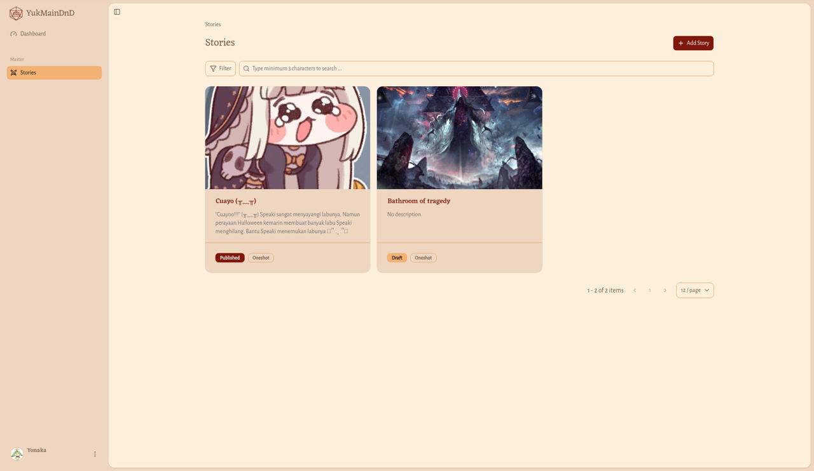

Setiap kartu menampilkan gambar sampul, judul (klik untuk membuka detail), cuplikan cerita (atau **No description.**), status, jenis, serta hadiah EXP dan GP kalau ada.

### Mencari, menyaring, dan mengurutkan

1. Ketik minimal 3 karakter di kolom pencarian.
2. Klik **Filter**, lalu atur:
   - **Sort By**: **Title**, **Status**, **Type**, **Game System**, **Max Members**, **EXP Awarded**, **Gold Awarded**, **Start At**, **Location**, **Created At**, atau **Updated At**.
   - **Sort Order**: **Ascending** atau **Descending**.
   - **Status** (**Select status**), **Type** (**Select type**), dan **Location** (**Select location**).
   - **Created By** (**Search user**): penulis Story. Ketik nama untuk mencari, lalu pilih dari daftar. Kalau tidak ada yang cocok, muncul **No users found.**
3. Klik **Apply**. Perubahan di jendela **Filter** baru berlaku setelah kamu klik **Apply**.

Klik **Clear** untuk kembali ke pengaturan awal: semua saringan dikosongkan, **Created By** kembali berisi namamu sendiri, dan daftar langsung diperbarui tanpa perlu klik **Apply**.

Kalau tidak ada hasil, muncul **No stories found.**

Di bawah daftar ada tulisan seperti "1 - 2 of 2 items". Pilih jumlah kartu per halaman: **6 / page**, **12 / page**, **24 / page**, atau **48 / page**.

### Melihat Story semua penulis

Saat kamu membuka **Stories**, daftar hanya menampilkan Story yang kamu tulis sendiri. Di jendela **Filter**, kolom **Created By** sudah terisi namamu.

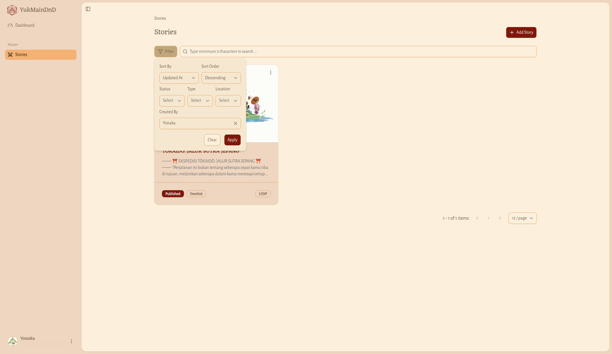

Untuk melihat Story yang ditulis semua DM:

1. Klik **Filter**.
2. Kosongkan kolom **Created By** (hapus isinya, atau klik ikon silang di ujung kolom).
3. Klik **Apply**.

Daftar Stories sekarang menampilkan Story semua penulis. Pilihan ini tetap berlaku walau halaman dimuat ulang. Untuk melihat Story satu DM tertentu saja, pilih namanya di **Created By**, lalu klik **Apply**. Untuk kembali ke Story milikmu saja, klik **Clear**.

### Aksi di setiap kartu

Klik ikon titik tiga (**Story actions**) di kartu. Untuk Story milik DM lain, pilihannya hanya **View**. Untuk Story yang kamu tulis, pilihannya antara lain **View**, **Edit**, **Archive**, **Cancel**, dan **Delete** (tergantung statusnya). **Complete** tidak ada di kartu; buka detail Story untuk menyelesaikannya. Setiap aksi (kecuali **View** dan **Edit**) meminta konfirmasi dulu. Lihat [Mengubah status Story](#mengubah-status-story).

## Membuat Story

**Siapa:** Dungeon Master.

1. Di halaman **Stories**, klik **Add Story** di pojok kanan atas.
2. Di halaman **Create Story**, isi form (lihat tabel).
3. Pilih cara menyimpan:
   - **Save as Draft**: simpan dulu tanpa menerbitkan. Muncul pesan **Story created** dan kamu kembali ke daftar Stories. Story berstatus **Draft** dan belum tampil di papan Story publik. Kamu bisa menerbitkannya nanti.
   - **Publish**: simpan dan langsung terbitkan, tanpa jendela konfirmasi. Muncul pesan **Creating story...** lalu **Story created**, dan kamu kembali ke daftar Stories. Story berstatus **Published** dan tampil di papan Story publik sebagai **Recruiting**, sehingga pemain bisa langsung bergabung.

Klik **Cancel** untuk kembali tanpa menyimpan.

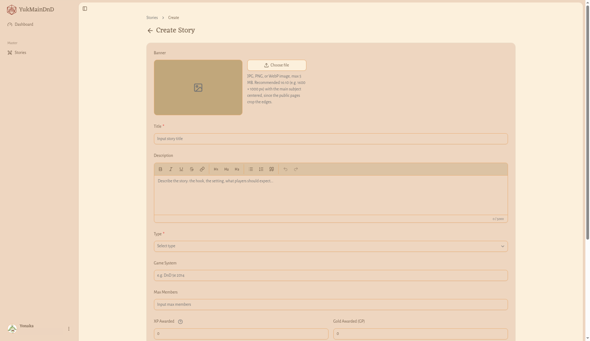

| Kolom | Wajib | Aturan |
| --- | --- | --- |
| Banner | Tidak | Klik **Choose file**. Gambar JPG, PNG, atau WebP, maksimal 5 MB. Disarankan rasio 16:10 (misalnya 1600 × 1000 px) dengan objek utama di tengah, karena tepinya terpotong di halaman publik. |
| Title | Ya | Maksimal 150 karakter, harus berisi minimal satu huruf atau angka |
| Description | Tidak | Cerita Story, maksimal 5000 karakter (penghitung seperti "0 / 5000" tampil di bawah kotak) |
| Type | Ya | **Oneshot** atau **Campaign** |
| Game System | Tidak | Maksimal 100 karakter, misalnya "DnD 5e 2014" |
| Max Members | Tidak | Bilangan bulat minimal 1. Ini jatah pemain yang dihadiahi; anggota lain tetap bisa ikut sebagai penonton. Kosongkan kalau tanpa batas. |
| EXP Awarded | Tidak bisa diisi | Terkunci di angka 1. Lihat [Hadiah Story yang sudah dibakukan](#hadiah-story-yang-sudah-dibakukan). |
| Gold Awarded (GP) | Tidak bisa diisi | Terkunci di angka 0. Lihat [Hadiah Story yang sudah dibakukan](#hadiah-story-yang-sudah-dibakukan). |
| Start At | Tidak | Tanggal (klik **Pick a date**) dan jam mulai |
| Location Type | Ya | **Online** atau **Offline** |
| Location Detail | Ya | Misalnya tautan Discord atau alamat tempat |
| Location Link | Tidak | Tautan peta lokasi, misalnya Google Maps (https://maps.app.goo.gl/...). Harus diawali https, maksimal 255 karakter. Boleh diisi untuk Story **Online** maupun **Offline**. |
| Discord Channel Link | Tidak | Tautan channel Discord Story (https://discord.gg/...). Harus diawali https dan beralamat discord.com, discord.gg, atau discordapp.com, maksimal 255 karakter. |
| Feedback Form Link | Tidak | Tautan formulir umpan balik untuk pemain, misalnya Google Form (https://forms.gle/...). Boleh tautan apa saja asalkan diawali https, maksimal 255 karakter. |

**Hasilnya:** muncul pesan **Story created**.

Di kolom **Type**, pilih **Oneshot** atau **Campaign**. Di kolom **Location Type**, pilih **Online** atau **Offline**.

### Menambahkan tautan peta, channel Discord, dan formulir umpan balik

Di bawah **Location Detail** ada tiga kolom tambahan yang boleh dikosongkan:

1. **Location Link**: tempel tautan peta tempat bermain, misalnya dari Google Maps. Kolom ini tidak bergantung pada **Location Type**, jadi Story **Online** pun boleh punya tautan lokasi.
2. **Discord Channel Link**: tempel tautan channel Discord tempat party berkumpul, misalnya tautan undangan https://discord.gg/....
3. **Feedback Form Link**: tempel tautan formulir untuk mengumpulkan kesan dan saran pemain setelah sesi, misalnya Google Form (https://forms.gle/...). Formulir lain juga boleh, asalkan tautannya diawali https.

Ketiga tautan harus diawali **https://** (tautan **http://** ditolak) dan paling panjang 255 karakter. Tautan Discord hanya diterima dari discord.com, discord.gg, atau discordapp.com.

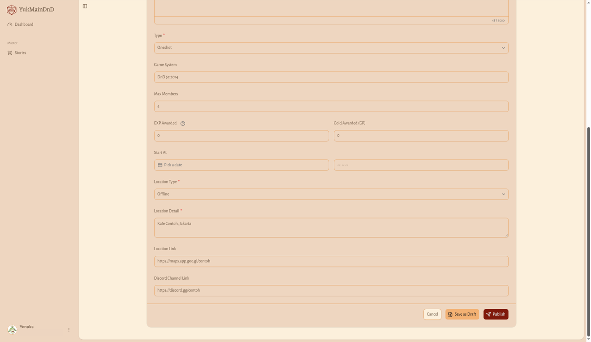

**Hasilnya:** setelah Story disimpan, tautan **Open location map** muncul di bawah keterangan lokasi, baris **Discord Channel** dengan tautan **Open Discord channel** muncul di detail Story, dan baris **Feedback Form** dengan tautan **Open feedback form** muncul di bawahnya. Semuanya tampil di detail Story milikmu, di detail Story pemain yang bergabung, dan di halaman Story publik, lalu terbuka di tab baru. Kalau kolomnya dikosongkan, tautannya tidak ditampilkan.

### Menulis cerita Story

Kotak **Description** punya bilah alat untuk merapikan tulisan:

- **Bold**, **Italic**, **Underline**, **Strikethrough**
- **Heading 1**, **Heading 2**, **Heading 3**
- **Bullet list**, **Numbered list**
- **Read-aloud text (quote)**: kotak teks untuk dibacakan DM ke pemain
- **Divider**: garis pemisah
- **Link**: isi **Link URL**, lalu klik **Apply**. Klik **Remove** untuk menghapus tautan. Hanya tautan http, https, atau mailto yang diterima.
- **Image**: isi **Image URL** (harus https) dan **Alt text (optional)**, lalu klik **Insert** (atau **Update** untuk gambar yang sudah ada).
- **Undo** dan **Redo**

### Mengisi tanggal dan jam mulai

1. Di **Start At**, klik **Pick a date** dan pilih tanggal di kalender.
2. Isi jam di kolom jam di sebelahnya.
3. Untuk mengosongkan, klik ikon silang di sebelah kolom jam.

Kalau kamu mengisi jam tanpa memilih tanggal, tanggalnya otomatis hari ini.

### Hadiah Story yang sudah dibakukan

Kolom **EXP Awarded** dan **Gold Awarded (GP)** tampil abu-abu dan tidak bisa diisi. Hadiah Story kini sama untuk semua Story:

- **EXP Awarded** selalu 1: setiap pemain yang hadir mendapat 1 EXP per Story.
- **Gold Awarded (GP)** selalu 0.

Klik ikon tanda tanya { width="18" style="vertical-align: text-bottom" } di sebelah label untuk membaca penjelasannya. Jendela kecil berjudul **Standardized reward** terbuka:

- di **EXP Awarded**: **EXP rewards are standardized: every attending player gets 1 EXP per story, so it can't be filled in here. The DM gets 1 DM EXP automatically, unless they also played.**
- di **Gold Awarded (GP)**: **Gold rewards are standardized for now, so they can't be filled in here.**

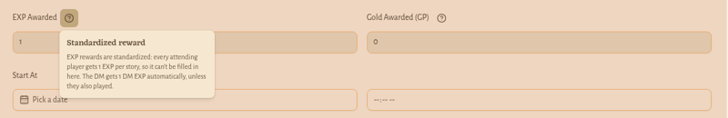

Kamu sendiri mendapat 1 **DM EXP** secara otomatis saat Story selesai. Lihat [Menyelesaikan Story dan membagi hadiah](#menyelesaikan-story-dan-membagi-hadiah).

### Mengunggah banner

1. Di **Banner**, klik **Choose file** dan pilih gambar.
2. Tunggu pesan **Banner uploaded**. Pratinjaunya langsung muncul.
3. Klik **Remove** kalau ingin membatalkan banner.

Pesan kesalahan banner: **Banner must be a JPG, PNG, or WebP image** atau **Banner must be 5 MB or smaller**.

Pesan kesalahan form lainnya: **Title is required**, **Title must be at most 150 characters**, **Title must contain at least one letter or number**, **Description must be at most 5000 characters**, **Type is required**, **Game system must be at most 100 characters**, **Max members must be a whole number of at least 1**, **Location type is required**, **Location detail is required**, **Location link must be an https link**, **Location link must be at most 255 characters**, **Discord channel link must be an https link on discord.com, discord.gg or discordapp.com**, **Discord channel link must be at most 255 characters**, **Feedback form link must be an https link**, **Feedback form link must be at most 255 characters**.

## Detail Story

**Cara membuka:** klik judul Story di daftar, atau pilih **View** dari ikon titik tiga di kartunya.

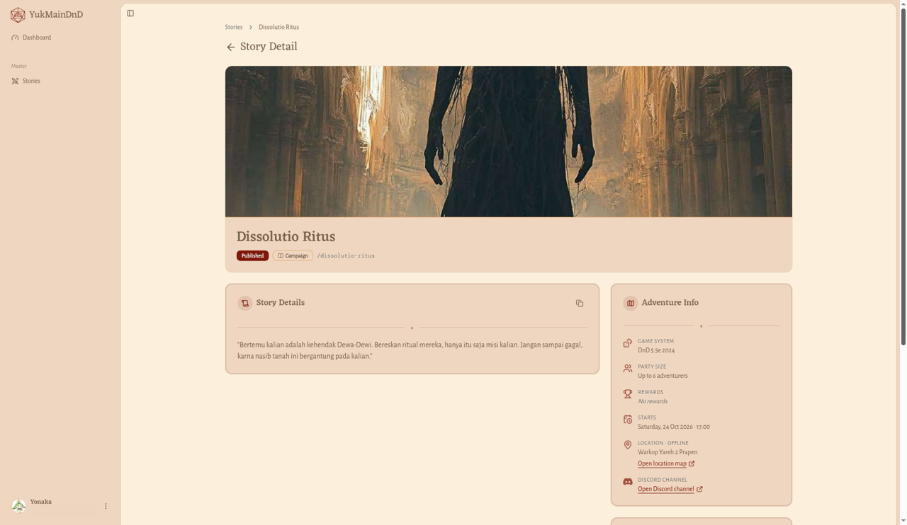

Halaman **Story Detail** berisi:

- Sampul: gambar, judul, status, jenis, dan alamat pendek Story (misalnya "/bathroom-of-tragedy"). Kalau Story berstatus **Published** atau **Completed**, alamat pendek itu bisa diklik (ada ikon panah kecil di sebelahnya) dan membuka halaman Story publiknya di tab baru, persis seperti yang dilihat pengunjung. Untuk Story **Draft**, **Archived**, dan **Cancelled**, alamat pendek hanya berupa teks biasa karena Story itu memang belum atau tidak lagi tampil di halaman publik.
- **Story Details**: cerita Story (atau **No description has been written for this story yet.**), dengan tombol salin untuk Discord.
- **Adventure Info**: **Game System**, **Party Size**, **Rewards**, **Starts**, dan lokasi. Kalau Story punya tautan peta, di bawah lokasi ada tautan **Open location map**. Kalau Story punya tautan Discord, ada baris **Discord Channel** (berlogo Discord) dengan tautan **Open Discord channel**. Kalau Story punya tautan formulir umpan balik, ada baris **Feedback Form** dengan tautan **Open feedback form**. Semua tautan ini terbuka di tab baru.
- **Chronicle**: siapa yang menulis dan kapan dibuat serta terakhir diubah.
- **Party**: anggota party (atau **No adventurers have joined this party yet.**).

Isinya sama dengan [detail Story di Board](../pemain/dashboard.md#detail-story-di-board-story-detail). Di Story yang kamu tulis, ada tambahan tombol aksi di samping judul (di layar kecil, di balik ikon titik tiga). Di Story milik DM lain, tombol itu tidak ada.

> Bagian di bawah ini (mengubah, mengubah status, menyelesaikan, dan mengatur anggota) hanya berlaku untuk **Story yang kamu tulis sendiri**.

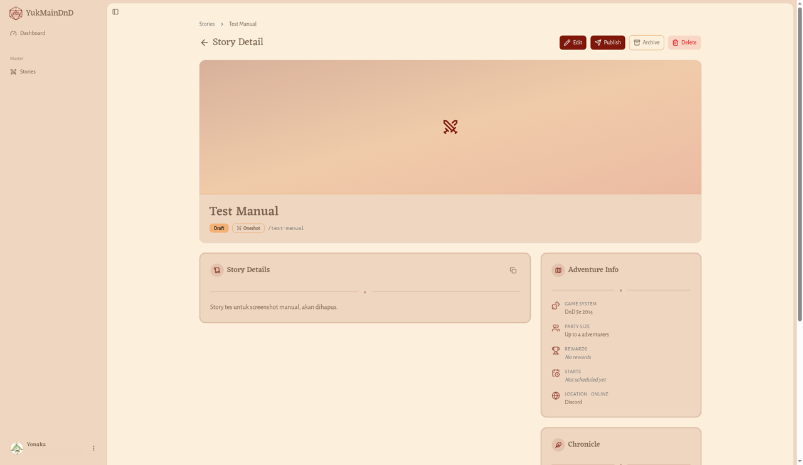

## Mengubah Story

1. Di detail Story, klik **Edit** (atau pilih **Edit** dari ikon titik tiga di kartu).
2. Halaman **Edit Story** terbuka dengan isian yang sudah terisi data Story-mu. Kolomnya sama dengan form membuat Story. Ubah yang perlu.
   - Untuk menghapus tautan peta, Discord, atau formulir umpan balik, kosongkan kolom **Location Link**, **Discord Channel Link**, atau **Feedback Form Link**. Setelah disimpan, tautannya hilang dari detail Story.
   - Kolom **EXP Awarded** dan **Gold Awarded (GP)** terkunci dan selalu menunjukkan 1 dan 0. Menyimpan perubahan tidak mengubah hadiah yang sudah tercatat di Story itu, jadi Story lama yang dulu diberi hadiah lain tetap memakai hadiah lamanya. Lihat [Hadiah Story yang sudah dibakukan](#hadiah-story-yang-sudah-dibakukan).
3. Klik **Save**.

**Hasilnya:** muncul pesan **Story updated** dan kamu dibawa ke detail Story.

Klik **Cancel** kalau tidak jadi mengubah; kamu kembali ke daftar Stories (bukan ke detail) tanpa menyimpan apa pun.

Story yang sudah selesai tidak bisa diubah. Kalau kamu membukanya, muncul pesan **Completed stories can't be edited**. Kalau Story itu bukan milikmu, muncul **You don't have permission to edit this story**. Dalam kedua kasus kamu dikembalikan ke halaman detail.

## Mengubah status Story

Aksi ini ada di detail Story, dan sebagian juga di ikon titik tiga pada kartu di daftar. Setiap aksi meminta konfirmasi dulu. Di setiap jendela, klik **Cancel** untuk menutup tanpa melakukan apa-apa.

### Menerbitkan (Publish)

1. Di detail Story berstatus **Draft**, klik **Publish**.
2. Jendela **Publish story?** muncul: **The story will be marked as published.**
3. Klik **Publish**.

**Hasilnya:** muncul pesan **Publishing story...** lalu **Story published**. Story tampil di papan Story publik sebagai **Recruiting** dan pemain bisa bergabung.

### Mengarsipkan (Archive)

1. Klik **Archive**.
2. Jendela **Archive story?** muncul: **The story will be marked as archived. You can unarchive it later to restore its previous status.**
3. Klik **Archive**.

**Hasilnya:** muncul pesan **Archiving story...** lalu **Story archived**. Label status berganti menjadi **Archived**, dan tombol yang tersisa hanya **Edit**, **Unarchive**, dan **Delete**.

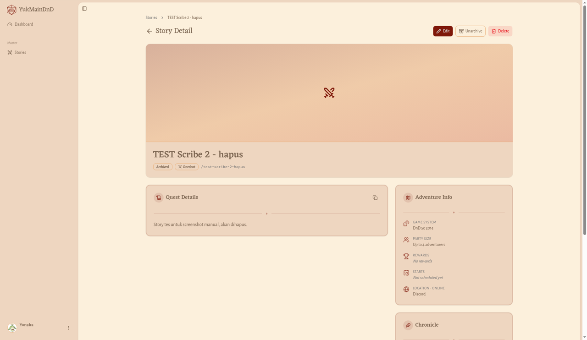

### Mengeluarkan dari arsip (Unarchive)

1. Di detail Story berstatus **Archived**, klik **Unarchive**.
2. Jendela **Unarchive story?** muncul: **The story will go back to the status it had before it was archived (Draft or Published).**
3. Klik **Unarchive**, atau **Cancel** untuk batal.

**Hasilnya:** muncul pesan **Story unarchived**. Status Story kembali seperti sebelum diarsipkan.

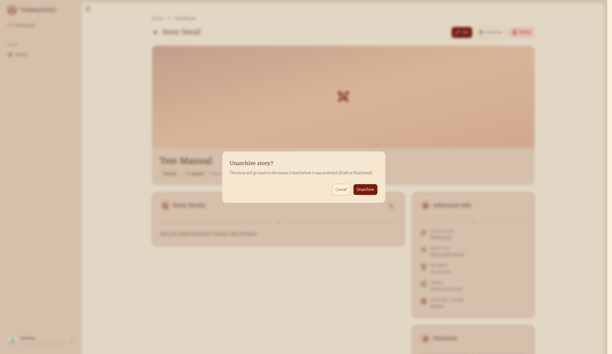

### Membatalkan (Cancel)

1. Di detail Story berstatus **Published**, klik **Cancel**.
2. Jendela **Cancel story?** muncul: **The story will be marked as cancelled. This cannot be undone. The story cannot be edited, and members cannot be added or removed.**
3. Klik **Cancel story**.

**Hasilnya:** muncul pesan **Story cancelled**.

> **Hati-hati:** Di jendela **Cancel story?**, tombol **Cancel** berarti "tutup jendela", sedangkan **Cancel story** berarti benar-benar membatalkan Story. Pembatalan Story tidak bisa dibatalkan balik.

### Menghapus (Delete)

1. Klik **Delete**.
2. Jendela **Delete story?** muncul: **This action cannot be undone. The story will be removed from the system.**
3. Klik **Delete**.

**Hasilnya:** muncul pesan **Deleting story...** lalu **Story deleted**. Story hilang dari daftar dan dari papan Story.

## Menyelesaikan Story dan membagi hadiah

**Untuk apa:** menandai Story sudah selesai, mencatat siapa yang hadir, dan memberi mereka hadiah.

**Complete** hanya muncul di detail Story berstatus **Published**.

1. Di detail Story, klik **Complete**.
2. Jendela **Complete story?** terbuka dengan keterangan **Choose who attended. Checked members are marked attended and receive rewards. Unchecked members are marked viewer and receive no rewards. The story and its members cannot be edited after this.**
3. Centang anggota yang hadir. Gunakan kolom pencarian (**Type minimum 3 characters to search ...**) kalau party-nya besar. Kalau belum ada anggota, jendela ini bertuliskan **No adventurers have joined this party yet.**
4. Klik **Complete story**, atau **Cancel** untuk batal.

Aturan jumlah yang dicentang: minimal 1 anggota, dan paling banyak sebanyak **Max Members** Story itu. Boleh kurang dari **Max Members**. Kalau tidak ada yang dicentang, muncul pesan **At least one attended member is required**. Kalau yang dicentang melebihi **Max Members**, muncul pesan **Attended members must not exceed max members of** diikuti angkanya (misalnya 6). Dalam kedua kasus Story belum selesai; ubah centangnya lalu coba lagi.

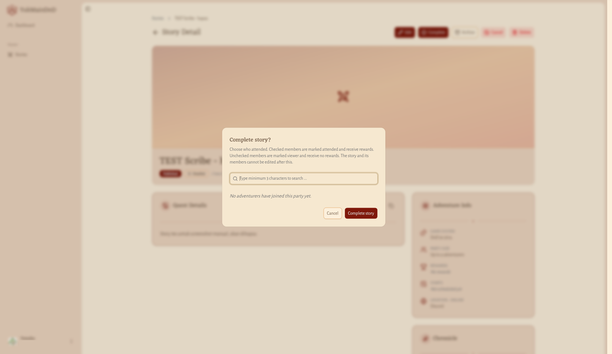

**Hasilnya:** muncul pesan **Story completed**. Anggota yang dicentang ditandai **Attended** dan menerima hadiah; yang tidak dicentang ditandai **Viewer** dan tidak menerima hadiah. Setelah ini, Story dan anggotanya tidak bisa diubah lagi.

Hadiah yang dibagikan otomatis saat Story selesai:

| Siapa | Hadiah |
| --- | --- |
| Setiap anggota yang dicentang hadir | **Player EXP** sebesar **EXP Awarded** Story (1 untuk Story baru), ditambah Gold sebesar **Gold Awarded (GP)** kalau lebih dari 0 |
| Kamu, penulis Story | 1 **DM EXP**, kecuali kamu sendiri ikut dan dicentang hadir sebagai pemain. Dalam hal itu kamu hanya mendapat hadiah pemain. |

Semua hadiah ini tercatat di [Balances](../pemain/saldo.md) masing-masing.

## Mengatur anggota party

**Siapa:** Dungeon Master yang menulis Story tersebut. Tombol **Add member** di kartu **Party** tersedia saat Story berstatus **Draft**, **Published**, maupun **Archived**.

### Menambah anggota

1. Di kartu **Party**, klik **Add member** (kalau party masih kosong), atau klik **Show more** lalu **Add**.
2. Jendela **Add member** terbuka berisi daftar petualang. Untuk mencari, ketik di kolom **Type minimum 3 characters to search ...**.
3. Centang petualang yang ingin ditambahkan.
4. Klik tombol tambah. Tulisannya berubah sesuai jumlah pilihanmu: **Add**, **Add 1 member**, atau misalnya "Add 3 members". Klik **Cancel** atau ikon silang untuk menutup tanpa menambah.

Petualang yang sudah ada di party tidak muncul di daftar. Namamu sendiri juga ada di daftar selama kamu belum ikut, jadi kamu bisa ikut sebagai pemain di Story yang kamu tulis. Kalau ikut, kamu dihitung dalam jatah **Max Members** seperti anggota lain. Kalau pencarian tidak menemukan siapa pun, muncul **No adventurers match this search.**

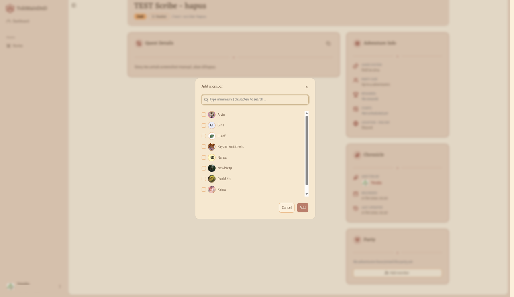

**Hasilnya:** muncul pesan **Story members added**. Kalau tidak ada lagi yang bisa ditambahkan, muncul **No adventurers are available to join.**

### Mengeluarkan anggota

1. Di kartu **Party**, klik **Show more**, lalu **Remove**.
2. Di jendela **Remove members** (**Remove adventurers from this party**), centang anggota yang ingin dikeluarkan.
3. Klik tombol hapus, misalnya **Remove 1 member** atau "Remove 2 members".

**Hasilnya:** muncul pesan **Story members removed**.
