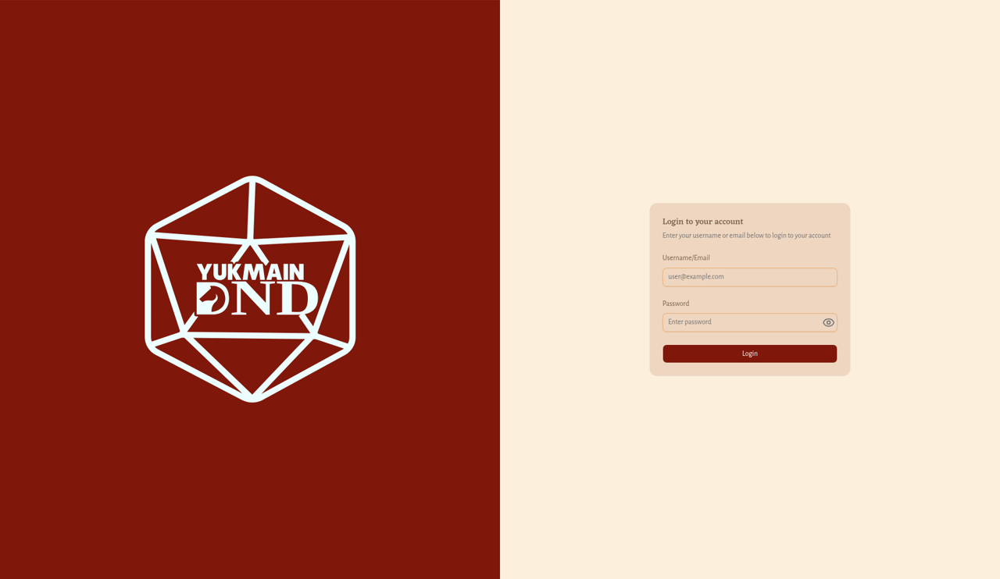
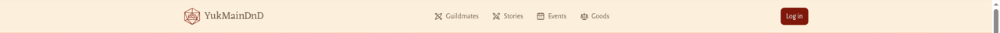
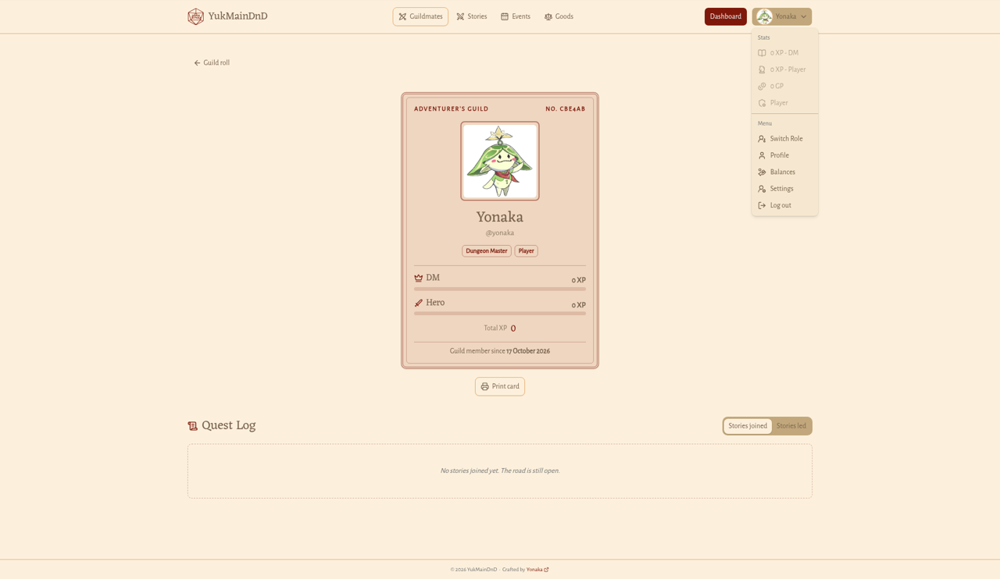
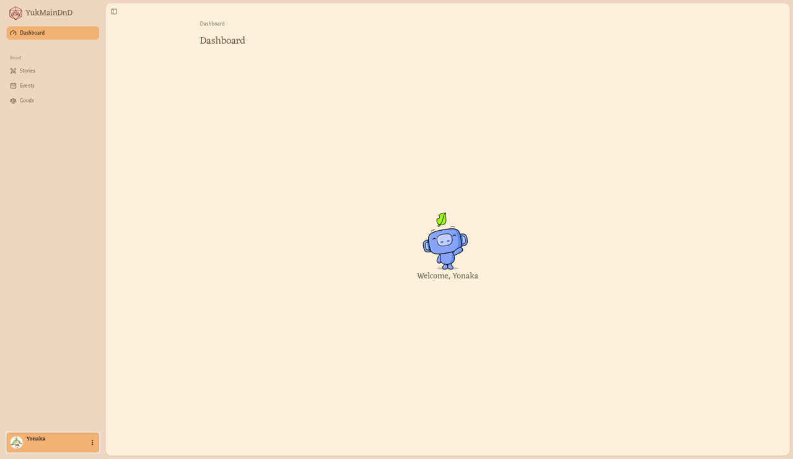

# Mulai di sini

Halaman ini membantumu masuk ke akun, keluar lagi, dan mengenal cara berpindah halaman di YukMainDnD.

> Seluruh tampilan YukMainDnD saat ini berbahasa Inggris. Nama tombol di panduan ini ditulis persis seperti di layar.

## Masuk ke akun

**Siapa:** semua orang yang sudah punya akun. Akun dibuatkan oleh pengurus guild; situs ini tidak punya halaman daftar akun sendiri.

1. Klik tombol merah **Log in** di pojok kanan atas. (Tombol **Join the guild** di Beranda juga membawamu ke halaman yang sama.)
2. Kamu sampai di halaman **Login to your account** dengan petunjuk **Enter your username or email below to login to your account**.
3. Isi **Username/Email** dengan username atau email akunmu. Kolom ini berisi contoh abu-abu **user@example.com** selama masih kosong.
4. Isi **Password** (kolomnya bertuliskan **Enter password**). Klik ikon mata di ujung kolom untuk menampilkan atau menyembunyikan sandi yang kamu ketik.
5. Klik **Login**.

| Kolom | Wajib | Aturan |
| --- | --- | --- |
| Username/Email | Ya | Username atau email akunmu |
| Password | Ya | Sandi akunmu |

**Hasilnya:** muncul pesan **Login Success**, lalu kamu dibawa kembali ke halaman yang tadi ingin kamu buka (atau ke Beranda). Kalau akunmu belum memilih role, kamu akan diminta memilihnya dulu di halaman **Switch Role**. Lihat [Memilih role](pemain/ganti-role.md).

> **Tips:** Kalau kamu membuka halaman khusus anggota (misalnya Dashboard) saat belum masuk, kamu otomatis diarahkan ke halaman masuk. Setelah berhasil masuk, kamu langsung kembali ke halaman tadi.

Kalau sudah masuk lalu membuka halaman masuk lagi, kamu otomatis dikembalikan ke Beranda.

Sesi masukmu tersimpan di peramban selama sekitar 7 hari. Setelah itu, atau kalau sesimu berakhir lebih cepat, kamu perlu masuk lagi.

## Keluar dari akun

1. Buka menu avatar:
   - di bilah atas, klik nama dan fotomu di pojok kanan atas;
   - di Dashboard, klik kartu nama di bagian bawah menu samping.
2. Pilih **Log out**.

**Hasilnya:** kamu keluar dari akun. Kalau saat itu kamu sedang di halaman khusus anggota, kamu diarahkan ke halaman masuk.

## Berpindah halaman

### Bilah atas (halaman publik)

Di setiap halaman publik ada bilah atas berisi:

- logo **YukMainDnD** di kiri: kembali ke Beranda;
- menu **Guildmates**, **Stories** (papan Story), **Events**, dan **Goods** di tengah. Menu halaman yang sedang kamu buka tampil berbingkai;
- tombol merah **Log in** di kanan kalau kamu belum masuk, atau tombol **Dashboard** dan menu avatar kalau sudah.

Di layar kecil (ponsel), menu ini disimpan di balik ikon tiga garis. Ketuk ikon itu untuk membuka panel **Menu**.

Di bagian paling bawah setiap halaman publik ada catatan kecil **© 2026 YukMainDnD · Crafted by Yonaka**. Nama **Yonaka** adalah tautan yang terbuka di tab baru.

### Menu avatar

Setelah masuk, bilah atas menampilkan tombol merah **Dashboard** dan nama serta fotomu di pojok kanan atas. Klik nama dan fotomu untuk membuka menu avatar. Menu avatar juga ada di kartu nama di bagian bawah menu samping Dashboard (klik ikon titik tiga di kartu itu).

Bagian **Stats** menampilkan:

- EXP-mu sebagai Dungeon Master (contoh: "120 XP - DM"),
- EXP-mu sebagai pemain (contoh: "80 XP - Player"),
- Gold-mu (contoh: "50 GP"),
- role yang sedang aktif (atau **Not set** kalau belum dipilih).

Bagian **Menu** berisi:

| Menu | Fungsinya |
| --- | --- |
| **Switch Role** | Memilih role yang aktif. [Lihat panduan](pemain/ganti-role.md) |
| **Profile** | Membuka kartu petualangmu sendiri. [Lihat panduan](pemain/profil-dan-pengaturan.md) |
| **Balances** | Riwayat EXP dan Gold-mu. [Lihat panduan](pemain/saldo.md) |
| **Settings** | Mengubah profil dan sandi. [Lihat panduan](pemain/profil-dan-pengaturan.md) |
| **Log out** | Keluar dari akun |

### Menu samping (Dashboard)

Setelah masuk, klik **Dashboard** di bilah atas. Di Dashboard ada menu samping berisi:

- logo **YukMainDnD** di paling atas,
- **Dashboard**: halaman sambutan bertuliskan "Welcome, (namamu)".
- **Board**: berisi **Stories** (membuka halaman **My Stories**, yaitu Story yang kamu ikuti), **Events**, dan **Goods**. Kelompok ini muncul kalau role aktifmu adalah Player.
- **Master**: berisi **Stories**, tempat Dungeon Master mengelola Story. Kelompok ini muncul kalau role aktifmu adalah Dungeon Master (dan kelompok **Board** tidak tampil). Lihat [Ikhtisar Dungeon Master](dungeon-master/ikhtisar.md).

Menu yang tampil mengikuti role yang sedang aktif. Role yang terlihat di situs antara lain **Player** dan **Dungeon Master**.

- kartu nama di bagian bawah, berisi foto, nama, dan email akunmu; dari sini kamu membuka menu avatar.

Menu yang sedang kamu buka tampil berwarna. Klik ikon panel di pojok kiri atas area isi untuk menyembunyikan atau menampilkan menu samping. Klik logo **YukMainDnD** di menu samping untuk kembali ke Beranda.

> Dashboard hanya bisa dibuka kalau kamu sudah memilih role. Kalau belum, kamu otomatis dibawa ke halaman **Switch Role** dulu. Lihat [Memilih role](pemain/ganti-role.md).

### Jejak halaman (breadcrumb)

Di bagian atas sebagian besar halaman Dashboard ada jejak halaman, misalnya "Users > Nama Pengguna > Balances". Klik bagian mana pun untuk kembali ke halaman itu. Banyak halaman detail juga punya tombol panah kiri di sebelah judul untuk kembali.

## Halaman tidak ditemukan

Kalau kamu membuka alamat yang tidak ada, muncul halaman **Page not found** dengan tulisan **The page you are looking for does not exist.** Klik **Go to Home** untuk pulang ke Beranda.
