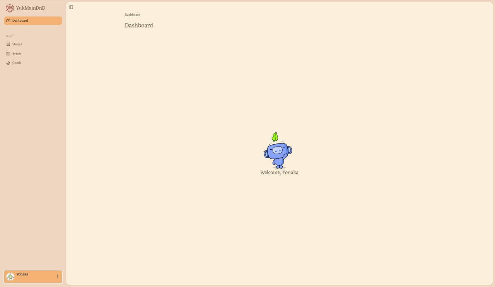
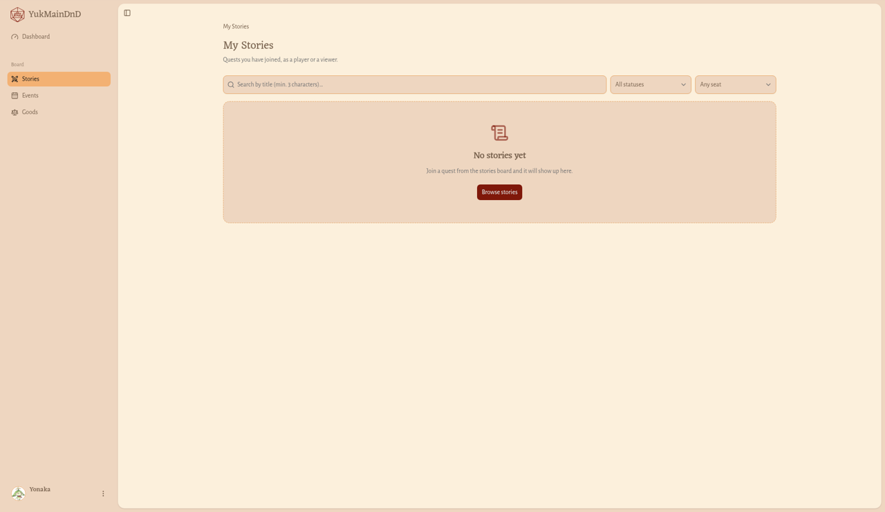
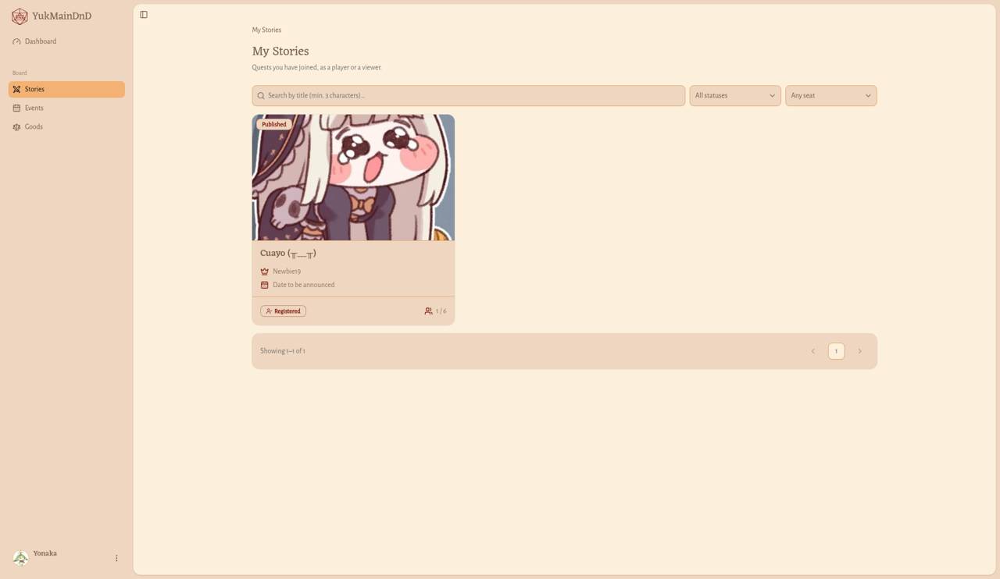
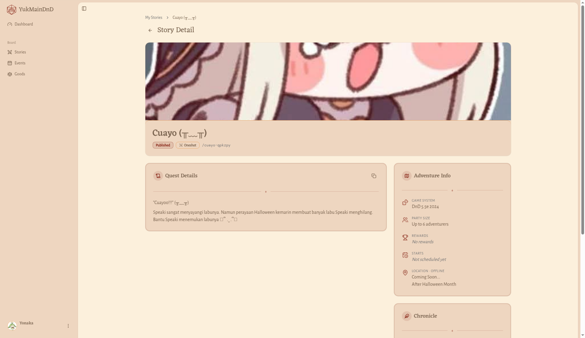

# Dashboard dan Quest-ku

## Dashboard

**Untuk apa:** halaman sambutan setelah kamu masuk, sekaligus pintu ke menu samping.

**Siapa yang bisa membuka:** semua pengguna yang sudah masuk dan sudah memilih role. Kalau kamu belum memilih role, kamu otomatis dibawa ke halaman [Switch Role](ganti-role.md) dulu; setelah memilih, kamu masuk ke Dashboard.

**Cara membuka:** klik tombol merah **Dashboard** di bilah atas, atau **Open my Board** di Beranda.

Kamu akan melihat judul **Dashboard** dan sapaan **Welcome, (namamu)**. Gunakan menu samping untuk membuka bagian lain. Lihat [Berpindah halaman](../getting-started.md#berpindah-halaman).

## Quest-ku (My Stories)

**Untuk apa:** melihat semua Quest yang kamu ikuti, baik sebagai pemain maupun penonton.

**Siapa yang bisa membuka:** pengguna dengan role Player yang aktif.

**Cara membuka:** di menu samping, di bawah **Board**, klik **Stories**. Halaman yang terbuka berjudul **My Stories** dengan keterangan **Quests you have joined, as a player or a viewer.**

Halaman **My Stories** menampilkan kartu untuk setiap Quest yang kamu ikuti:

- gambar sampul dan label status Quest (**Published**, **Completed**, **Cancelled**, atau **Archived**),
- judul Quest (klik untuk membuka detail),
- **Dungeon Master** (atau **Unknown DM**),
- **Starts**: hari dan jam mulai (atau **Date to be announced**),
- label posisimu di party: **Registered** (terdaftar), **Viewer** (penonton), atau **Attended** (hadir),
- **Members**: jumlah anggota, misalnya "1 / 6" kalau ada jatah pemain.

### Mencari dan menyaring

1. Ketik judul di kolom **Search by title (min. 3 characters)…**. Hasil diperbarui setelah minimal 3 huruf.
2. Di pilihan status, pilih **All statuses**, **Published**, **Completed**, **Cancelled**, atau **Archived**.
3. Di pilihan posisimu, pilih **Any seat**, **Registered**, **Viewer**, atau **Attended**.

Saringan langsung berlaku begitu kamu memilih.

Setiap halaman memuat 12 Quest. Di bawah daftar ada tulisan seperti "Showing 1–1 of 1". Klik nomor halaman atau panah untuk berpindah.

### Kalau daftarmu kosong

- Kalau kamu belum ikut Quest apa pun, muncul **No stories yet** dengan catatan **Join a quest from the stories board and it will show up here.** Klik **Browse stories** untuk membuka [papan Quest](../pengunjung/quest.md) dan bergabung dengan sebuah party.
- Kalau saringanmu tidak cocok, muncul **No stories match**. Klik **Clear filters**.
- Kalau gagal dimuat, muncul **Could not load your stories**. Klik **Try again**.

## Detail Quest di Board (Story Detail)

**Untuk apa:** melihat semua informasi tentang Quest yang kamu ikuti, termasuk detail tempat bermain dan daftar lengkap party.

**Siapa yang bisa membuka:** pengguna dengan role Player yang aktif, untuk Quest yang ia ikuti.

**Cara membuka:** klik judul Quest di halaman **My Stories**.

Halaman **Story Detail** berisi:

- Sampul: gambar, judul, status, dan jenis Quest.
- **Quest Details**: cerita lengkap Quest (atau **No description has been written for this quest yet.**).
- **Adventure Info**:
  - **Game System** (atau **Any system**),
  - **Party Size**, misalnya "Up to 6 adventurers" (atau **No limit**),
  - **Rewards**, misalnya "10 XP · 50 GP" (atau **No rewards**),
  - **Starts** (atau **Not scheduled yet**),
  - **Location · Online** atau **Location · Offline**, berisi detail tempat atau tautan.
- **Chronicle**: **Written By** (nama Dungeon Master, klik untuk membuka kartu petualangnya), **Recorded** (tanggal dibuat), dan **Last Updated**.
- **Party**: foto anggota party.

Klik panah kiri di sebelah judul, atau **My Stories** di jejak halaman, untuk kembali.

### Menyalin cerita Quest untuk Discord

1. Di kartu **Quest Details**, klik ikon salin (**Copy for Discord**) di pojok kanan atas.
2. Muncul pesan **Description copied**.
3. Tempel di Discord atau aplikasi lain.

Kalau gagal, muncul **Couldn't copy the description**. Coba lagi, atau pastikan perambanmu mengizinkan akses papan klip.

### Melihat seluruh anggota party

1. Di kartu **Party**, klik **Show more**.
2. Jendela **Party** terbuka dengan daftar lengkap anggota beserta label **Registered**, **Viewer**, atau **Attended**.
3. Untuk mencari anggota, ketik minimal 3 huruf di kolom **Type minimum 3 characters to search ...**.
4. Gulir ke bawah; anggota berikutnya dimuat otomatis.

Kalau belum ada anggota, muncul **No adventurers have joined this party yet.**

> **Perlu kamu tahu:** Halaman ini hanya untuk melihat. Untuk bergabung atau keluar dari party, buka halaman Quest di [papan Quest](../pengunjung/quest.md#detail-quest).

## Events dan Goods di Board

Di menu samping, di bawah **Board**, ada juga **Events** dan **Goods**. Keduanya masih menampilkan **Coming Soon** (**This page is still under development.**).
