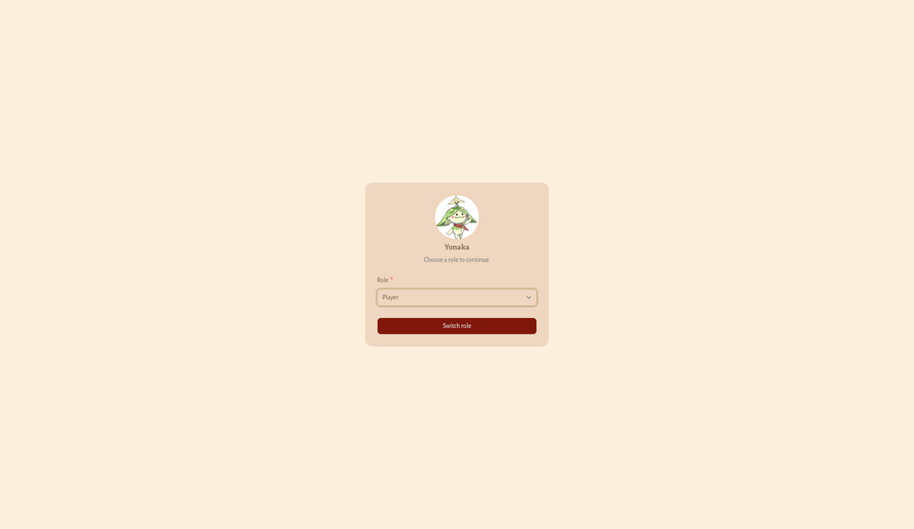

# Memilih role (Switch Role)

**Untuk apa:** satu akun bisa punya lebih dari satu role. Role yang sedang aktif menentukan menu dan aksi apa saja yang bisa kamu pakai di Dashboard. Role yang sedang aktif tampil di bagian **Stats** pada menu avatar.

**Siapa yang bisa membuka:** semua pengguna yang sudah masuk.

## Kapan halaman ini muncul

- Otomatis, kalau akunmu belum punya role aktif. Kamu tidak bisa membuka Dashboard atau halaman Saldo sebelum memilih role. (Halaman Pengaturan dan Profil tetap bisa dibuka.)
- Kapan saja kamu mau, lewat menu avatar: pilih **Switch Role**.

## Langkah-langkah

1. Di kartu yang berisi foto dan namamu, lihat tulisan **Choose a role to continue.**
2. Klik kolom **Role** dan pilih role yang ingin kamu pakai. Daftarnya hanya berisi role yang diberikan untuk akunmu.
3. Klik **Switch role**.

| Kolom | Wajib | Aturan |
| --- | --- | --- |
| Role | Ya | Pilih salah satu role milik akunmu. Kalau kosong, muncul **Role is required**. |

**Hasilnya:** muncul pesan **Role switched successfully**. Kamu dibawa kembali ke halaman yang tadi ingin kamu buka, atau ke Dashboard kalau kamu membuka halaman ini dari menu avatar. Menu samping Dashboard langsung menyesuaikan dengan role barumu: **Board** untuk Player, **Master** untuk Dungeon Master.

## Kalau tidak ada role

Kalau akunmu belum diberi role sama sekali, kolom **Role** tidak bisa dipilih dan muncul catatan **No roles are available for this account.** Hubungi pengurus guild supaya akunmu diberi role.
