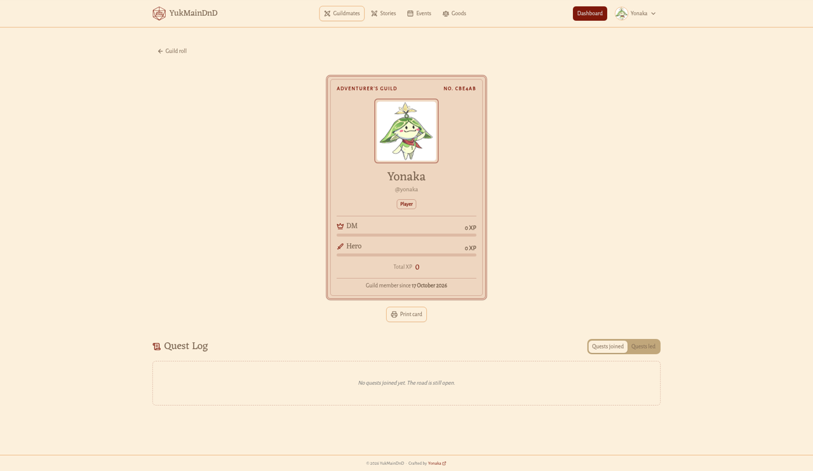
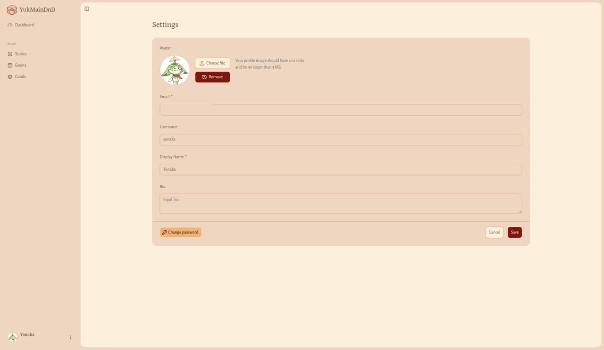
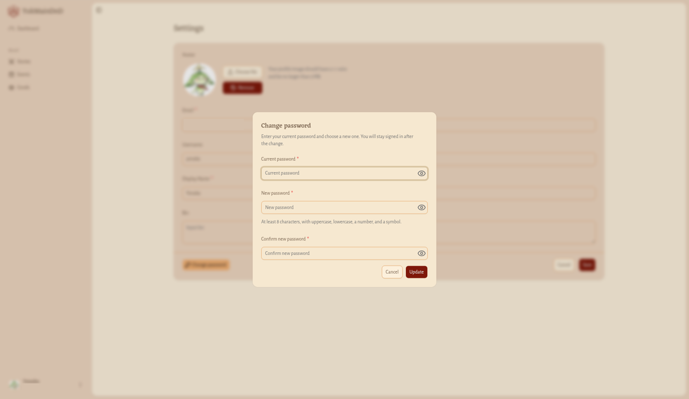

# Profil dan Pengaturan

## Profil

**Untuk apa:** melihat kartu petualangmu sendiri, persis seperti yang dilihat orang lain.

**Siapa yang bisa membuka:** semua pengguna yang sudah masuk.

**Cara membuka:** buka menu avatar, lalu pilih **Profile**.

**Hasilnya:** kamu langsung dibawa ke halaman kartu petualangmu yang publik di bagian Guildmates (menu **Guildmates** di bilah atas tampil aktif). Halaman ini sama persis dengan yang dilihat pengunjung lain: kartu dengan role-mu, XP sebagai **DM** dan **Hero**, **Total XP**, **Guild member since**, tombol **Print card**, dan **Quest Log**. Lihat [Kartu petualang](../pengunjung/guildmates.md#kartu-petualang-detail-guildmate).

Halaman Profil hanya untuk melihat. Untuk mengubah foto, nama, atau bio, buka **Settings**.

## Pengaturan (Settings)

**Untuk apa:** mengubah foto, email, username, nama tampilan, bio, dan sandi.

**Siapa yang bisa membuka:** semua pengguna yang sudah masuk, termasuk yang belum memilih role.

**Cara membuka:** buka menu avatar, lalu pilih **Settings**. Halaman **Settings** tampil dengan menu samping Dashboard.

### Mengubah profil

1. Ubah kolom yang ingin kamu ganti (lihat tabel di bawah).
2. Klik **Save**.

Klik **Cancel** kalau tidak jadi; kamu dibawa ke Dashboard tanpa menyimpan apa pun.

| Kolom | Wajib | Aturan |
| --- | --- | --- |
| Avatar | Tidak | File gambar, rasio 1:1, maksimal 3 MB |
| Email | Ya | Alamat email yang valid |
| Username | Tidak | Maksimal 50 karakter |
| Display Name | Ya | Maksimal 100 karakter |
| Bio | Tidak | Maksimal 50 karakter |

Kolom yang wajib diisi ditandai dengan bintang.

**Hasilnya:** muncul pesan **Profile updated**, dan namamu, fotomu, serta datamu yang lain langsung diperbarui di seluruh aplikasi.

Pesan kesalahan yang mungkin muncul:

- **Email is required** atau **Invalid email**
- **Username must be at most 50 characters**
- **Display name is required** atau **Display name must be at most 100 characters**
- **Bio must be at most 50 characters**

Kalau server menolak salah satu isian, pesannya tampil langsung di bawah kolom yang bermasalah.

### Mengganti foto profil

Di sebelah tombol foto ada catatan **Your profile image should have a 1:1 ratio and be no larger than 3 MB.**

1. Di bagian **Avatar**, klik **Choose file**.
2. Pilih file gambar dari perangkatmu.
3. Tunggu pesan **Avatar uploaded**. Pratinjau fotomu langsung muncul.
4. Klik **Save** untuk menyimpan perubahan.

> **Penting:** Foto baru belum tersimpan di profilmu sebelum kamu klik **Save**.

Untuk menghapus foto, klik **Remove**, lalu **Save**. Tanpa foto, aplikasi menampilkan gambar inisial namamu.

Pesan kesalahan yang mungkin muncul:

- **Avatar must be an image file**: file yang kamu pilih bukan gambar.
- **Avatar must be 3 MB or smaller**: ukurannya terlalu besar.

### Mengganti sandi

1. Klik **Change password**.
2. Jendela **Change password** terbuka dengan keterangan **Enter your current password and choose a new one. You will stay signed in after the change.** Isi kolom-kolomnya (lihat tabel). Di bawah kolom **New password** ada petunjuk **At least 8 characters, with uppercase, lowercase, a number, and a symbol.**
3. Klik **Update**.

Klik **Cancel** untuk menutup jendela tanpa mengganti sandi. Klik ikon mata di setiap kolom untuk melihat sandi yang kamu ketik.

| Kolom | Wajib | Aturan |
| --- | --- | --- |
| Current password | Ya | Sandimu yang sekarang |
| New password | Ya | Minimal 8 karakter, berisi huruf besar, huruf kecil, angka, dan simbol |
| Confirm new password | Ya | Harus sama persis dengan sandi baru |

**Hasilnya:** muncul pesan **Password updated** dan jendela tertutup. Kamu tetap masuk setelah sandi diganti.

Pesan kesalahan yang mungkin muncul:

- **Current password is required**
- **Password must be at least 8 characters**
- **Password must include a lowercase letter**
- **Password must include an uppercase letter**
- **Password must include a number**
- **Password must include a symbol**
- **Confirm your new password**
- **Passwords do not match**
