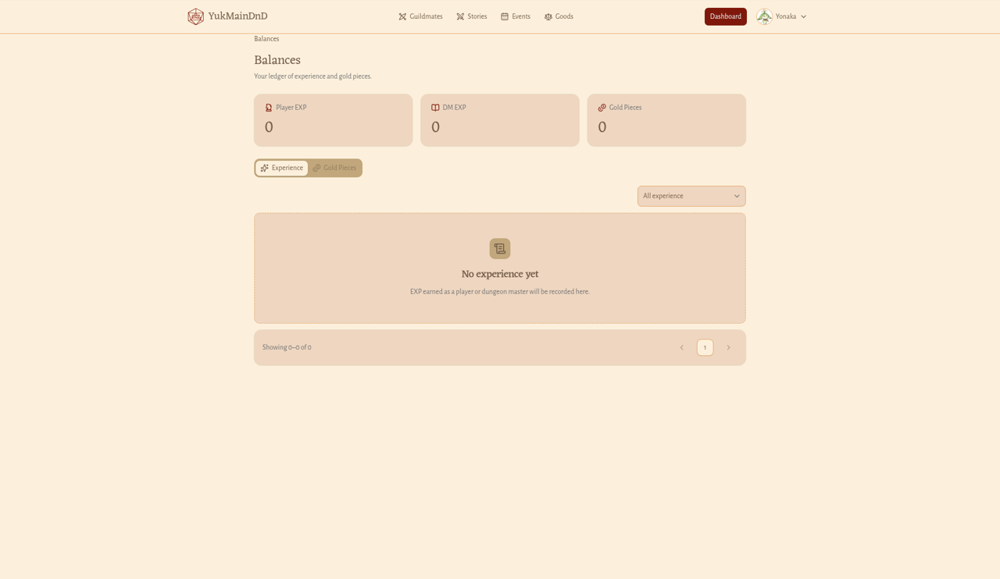
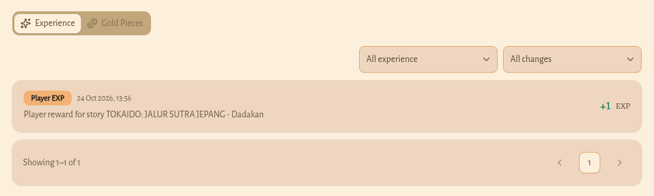

# Saldo EXP dan Gold (Balances)

**Untuk apa:** buku catatanmu. Di sini kamu melihat jumlah EXP dan Gold yang kamu punya sekarang, dan riwayat setiap kali EXP atau Gold-mu bertambah atau berkurang.

**Siapa yang bisa membuka:** semua pengguna yang sudah masuk dan sudah memilih role.

**Cara membuka:** buka menu avatar, lalu pilih **Balances**. Halaman ini memakai bilah atas yang sama dengan halaman publik, bukan menu samping Dashboard.

## Ringkasan saldo

Di bagian atas halaman **Balances** (**Your ledger of experience and gold pieces.**) ada tiga kotak:

- **Player EXP**: EXP yang kamu kumpulkan sebagai pemain.
- **DM EXP**: EXP yang kamu kumpulkan sebagai Dungeon Master.
- **Gold Pieces**: jumlah Gold (GP) yang kamu punya.

Angka besar ditulis singkat, misalnya "1.2k". Klik angka itu untuk melihat jumlah persisnya, lalu klik **Close**.

## Riwayat EXP dan Gold

1. Pilih tab **Experience** untuk riwayat EXP, atau **Gold Pieces** untuk riwayat Gold.
2. Kalau perlu, saring jenisnya lewat pilihan di atas daftar:
   - di tab **Experience**: **All experience**, **Player EXP**, atau **Dungeon Master EXP**;
   - di tab **Gold Pieces**: **All gold**, **Gold earned**, atau **Gold spent**.

Setiap baris menampilkan jenis catatan, tanggal dan jam, keterangan (atau "—" kalau kosong), serta jumlahnya. Jumlah yang bertambah ditandai **+** dan berwarna hijau; yang berkurang ditandai **−** dan berwarna merah.

Riwayat diurutkan dari yang terbaru. Setiap halaman memuat 10 catatan. Di bawah daftar ada tulisan seperti "Showing 1–10 of 25". Klik nomor halaman atau panah untuk berpindah.

## Kalau daftarnya kosong

- Belum ada EXP: **No experience yet** (**EXP earned as a player or dungeon master will be recorded here.**)
- Belum ada Gold: **No gold yet** (**Gold you earn or spend will be recorded here.**)
- Saringan tidak cocok: **No entries match**. Klik **Clear filter**.
- Gagal dimuat: **Could not load the ledger**. Klik **Try again**.

> **Dari mana EXP dan Gold berasal?** EXP dan Gold kamu dapatkan terutama saat Dungeon Master menyelesaikan sebuah Story dan menandaimu hadir. Kamu tidak bisa mengubah saldo sendiri.
