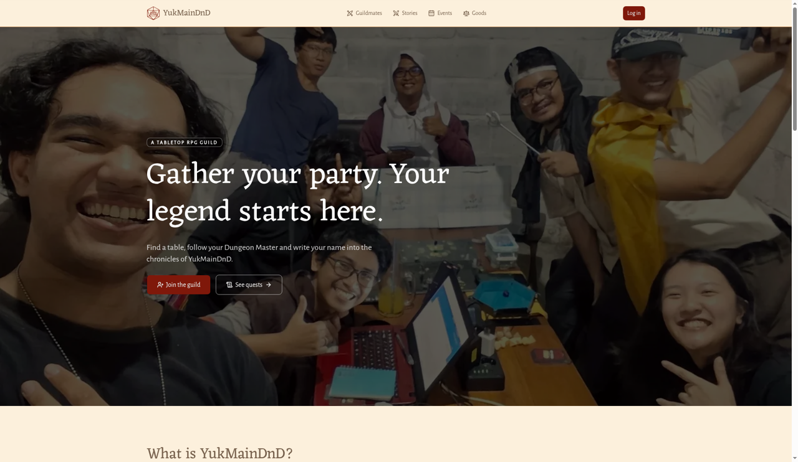
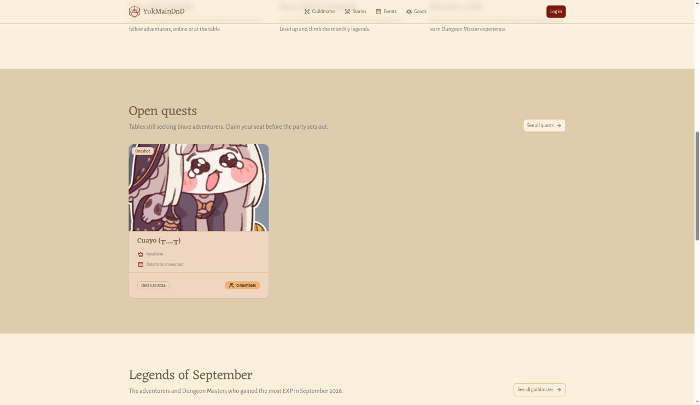
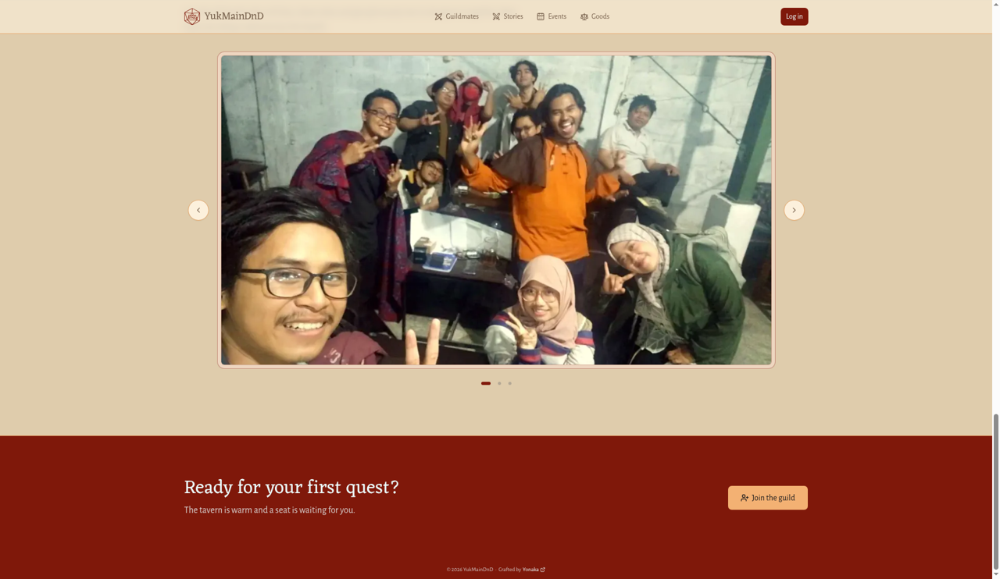

# Beranda

**Untuk apa:** gerbang utama YukMainDnD. Dari sini kamu bisa melihat Quest yang sedang buka, para Legends bulan lalu, dan foto-foto kehidupan guild.

**Siapa yang bisa membuka:** semua orang, tanpa perlu masuk.

**Cara membuka:** buka alamat utama situs, atau klik logo **YukMainDnD** di bilah atas.

## Apa saja yang ada di Beranda

Gulir ke bawah dan kamu akan menemukan bagian-bagian berikut, berurutan:

### 1. Sambutan

Di atas foto guild ada label kecil **A TABLETOP RPG GUILD**, judul besar **Gather your party. Your legend starts here.**, dan dua tombol:

- **Join the guild** (merah): membuka halaman masuk. Kalau kamu sudah masuk, tombol ini berganti menjadi **Open my Board** dan membawamu ke Dashboard.
- **See quests**: membuka papan Quest. Lihat [Papan Quest](quest.md).

### 2. What is YukMainDnD?

Tiga langkah singkat (**Step 1**, **Step 2**, **Step 3**) tentang cara bermain di guild: **Play with friends**, **Earn EXP & rewards**, dan **Become a DM**.

### 3. Open quests

Sampai tiga Quest yang sedang membuka pendaftaran. Setiap kartu menampilkan:

- gambar sampul dan jenis Quest (**Oneshot** atau **Campaign**),
- judul Quest (klik kartunya untuk membuka detail),
- nama Dungeon Master (atau **Unknown DM**),
- tanggal mulai (atau **Date to be announced** kalau belum ditentukan),
- sistem permainan (atau **Any system**),
- jumlah anggota, misalnya "4 members".

Klik **See all quests** untuk membuka papan Quest lengkap.

Kalau belum ada Quest, kamu akan melihat pesan **No quests are posted on the board right now. Check back soon.**

### 4. Legends bulan lalu

Judulnya mengikuti nama bulan lalu, misalnya **Legends of September**. Ada dua papan:

- **Heroes**: tiga pemain dengan tambahan EXP terbanyak bulan lalu.
- **Dungeon Masters**: tiga DM dengan tambahan EXP terbanyak bulan lalu.

Setiap baris menunjukkan peringkat, nama (klik untuk membuka kartu petualangnya), username, dan EXP yang didapat, misalnya "+35 XP in September". Klik **See all guildmates** untuk membuka [daftar Guildmates](guildmates.md).

Kalau bulan lalu belum ada yang mengumpulkan EXP, muncul pesan yang diawali **No legends in** dan diakhiri **The tavern awaits.**

### 5. Life in the guild

Kumpulan foto kegiatan guild yang bisa digeser.

1. Klik panah kiri atau kanan untuk berpindah foto, atau klik salah satu titik di bawahnya.
2. Klik sebuah foto untuk memperbesarnya.
3. Klik ikon silang untuk menutup foto besar.

### 6. Ready for your first quest?

Ajakan penutup bertuliskan **Ready for your first quest?** dan **The tavern is warm and a seat is waiting for you.**, dengan satu tombol: **Join the guild** (kalau belum masuk) atau **Find a quest** (kalau sudah masuk, membuka papan Quest).

## Kalau ada bagian yang gagal dimuat

Kalau papan Quest atau papan Legends tidak bisa dimuat, kamu akan melihat pesan seperti **The quest board could not be read.** atau **The legends are lost to the mist.** Klik **Try again** untuk memuat ulang bagian itu saja.
