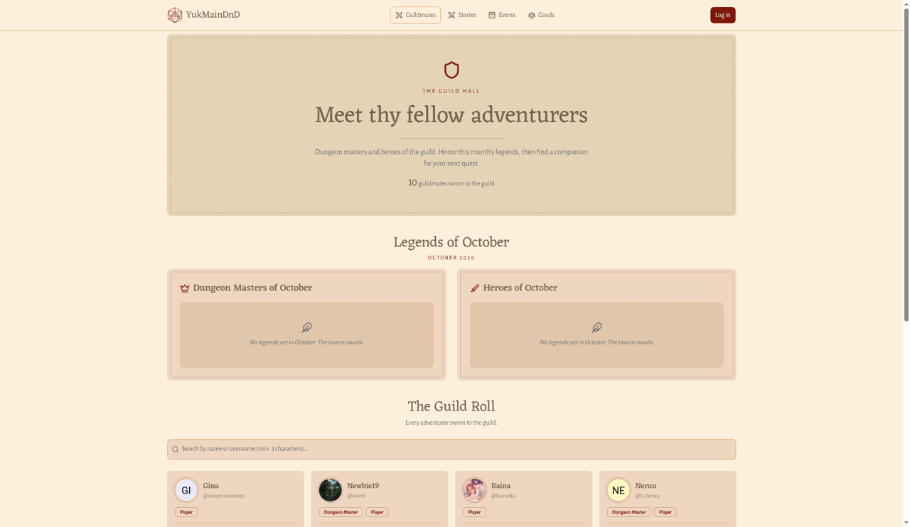
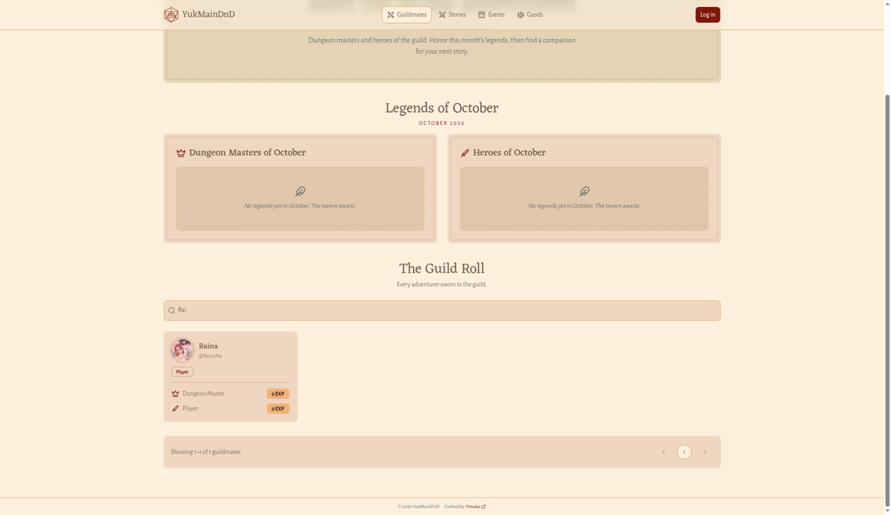
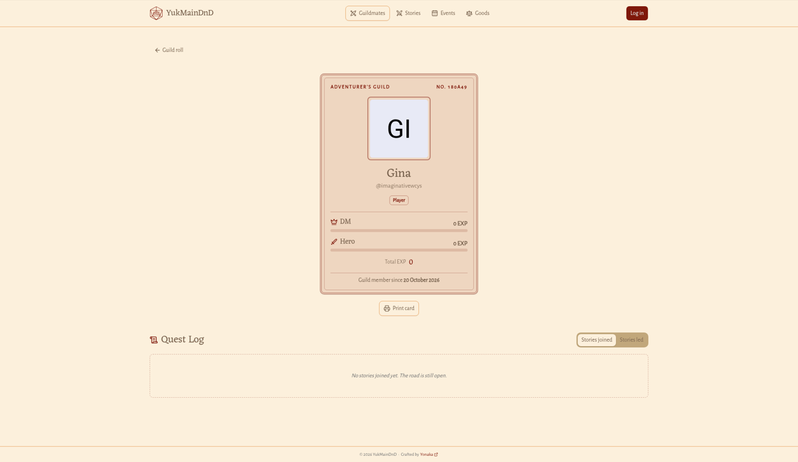

# Guildmates dan kartu petualang

## Daftar Guildmates

**Untuk apa:** kenalan dengan semua petualang dan Dungeon Master di guild, dan melihat siapa Legends bulan ini.

**Siapa yang bisa membuka:** semua orang, tanpa perlu masuk.

**Cara membuka:** klik **Guildmates** di bilah atas, atau **See all guildmates** di Beranda.

### The Guild Hall

Di bagian atas ada label **THE GUILD HALL**, judul **Meet thy fellow adventurers**, dan jumlah anggota, misalnya "10 guildmates sworn to the guild". Jumlah ini disembunyikan selama kamu sedang mencari.

### Legends bulan ini

Bagian **Legends of …** (misalnya **Legends of October**) berisi dua papan peringkat:

- **Dungeon Masters of …**: tiga DM dengan tambahan EXP terbanyak bulan ini.
- **Heroes of …**: tiga pemain dengan tambahan EXP terbanyak bulan ini.

Setiap tempat menampilkan nama (klik untuk membuka kartu petualang), total EXP-nya, dan tambahan EXP bulan ini, misalnya "+40 EXP so far". Tempat yang masih kosong bertuliskan **Unclaimed** dengan catatan **Awaiting a master** atau **Awaiting a hero**.

Di layar kecil, kedua papan ini ditampilkan bergantian. Ketuk tab **Dungeon Masters** atau **Heroes** untuk berpindah.

Kalau belum ada yang mengumpulkan EXP bulan ini, muncul pesan seperti **No legends yet in October. The tavern awaits.**

### The Guild Roll

Di bawahnya ada **The Guild Roll** (**Every adventurer sworn to the guild.**) berisi kartu setiap anggota: foto, nama, username, role-nya, serta EXP sebagai **Dungeon Master** dan sebagai **Player**.

#### Mencari anggota

1. Ketik nama atau username di kolom **Search by name or username (min. 3 characters)…**.
2. Hasil diperbarui otomatis setelah kamu mengetik minimal 3 karakter.

Kalau tidak ada yang cocok, muncul **No guildmates found** dan tombol **Clear search**.

#### Berpindah halaman

Setiap halaman memuat 12 anggota. Di bawah daftar ada tulisan seperti "Showing 1–12 of 42 guildmates". Klik nomor halaman atau panah untuk berpindah.

Kalau daftar gagal dimuat, muncul **The guild roll could not be fetched**. Klik **Try again**.

## Kartu petualang (detail Guildmate)

**Untuk apa:** melihat kartu petualang seseorang: EXP-nya, sejak kapan bergabung, kisahnya, dan Story yang pernah ia ikuti atau pimpin.

**Siapa yang bisa membuka:** semua orang.

**Cara membuka:** klik nama seseorang di mana saja (daftar Guildmates, papan Legends, daftar party, atau nama Dungeon Master di sebuah Story).

Halaman ini berisi:

- Tombol **Guild roll** untuk kembali ke daftar Guildmates.
- Kartu petualang bertuliskan **ADVENTURER'S GUILD** dan nomor kartu (misalnya "NO. 150A49"), berisi:
  - foto, nama, dan username,
  - role-nya (atau **Wandering adventurer** kalau tidak ada),
  - EXP sebagai **DM** dan sebagai **Hero**, beserta porsinya dari total,
  - **Total EXP**,
  - **Guild member since** (tanggal bergabung).
- **The Adventurer's Tale**: bio singkat, kalau sudah diisi.
- **Quest Log**: daftar Story yang terkait dengan orang ini.

### Mencetak kartu petualang

1. Klik **Print card** di bawah kartu.
2. Jendela cetak perambanmu terbuka. Halaman pertama berisi sisi depan kartu, halaman kedua berisi sisi belakang dengan lambang guild dan motto **Roll bold, play fair, tell good tales.**
3. Pilih printer atau simpan sebagai PDF.

### Melihat Quest Log

1. Pilih tab **Stories joined** (Story yang ia ikuti sebagai anggota) atau **Stories led** (Story yang ia jalankan sebagai Dungeon Master).
2. Setiap kartu Story menampilkan status (misalnya **Recruiting** atau **Completed**), jenis, lokasi, cuplikan cerita, tanggal mulai, jumlah yang bergabung, jatah pemain, dan nama Dungeon Master.
3. Klik **Load more** untuk menampilkan Story berikutnya.

Kalau belum ada, muncul **No stories joined yet. The road is still open.** atau **No stories led yet. Their first tale awaits.**

Kalau orang yang dicari tidak ada, kamu akan melihat halaman **Page not found**.
