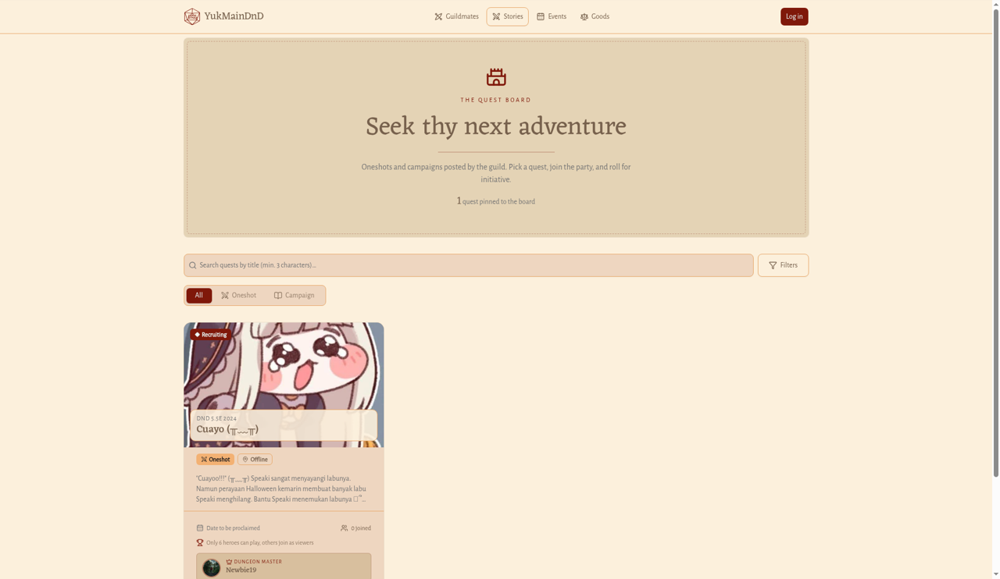
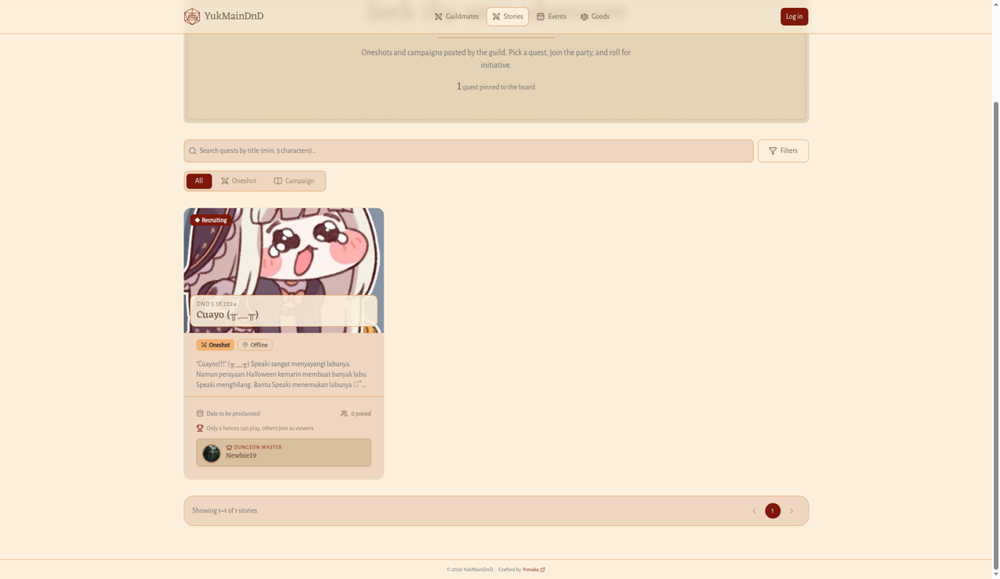
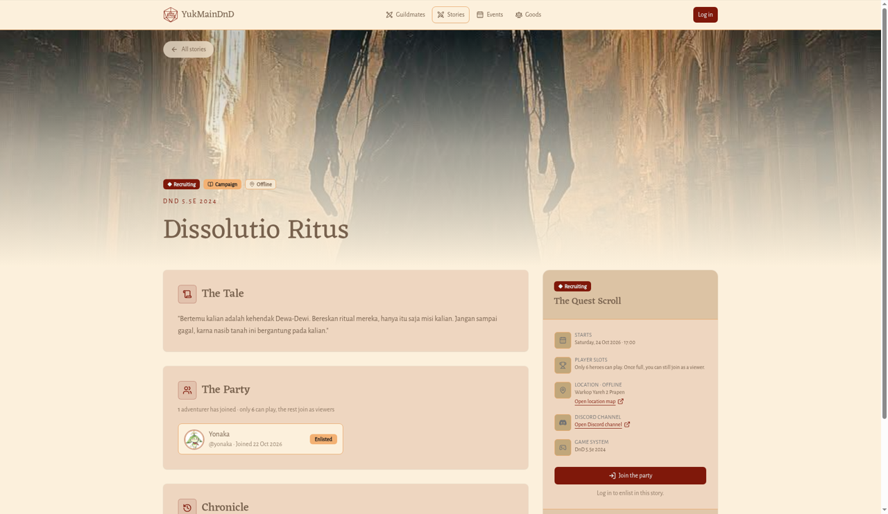
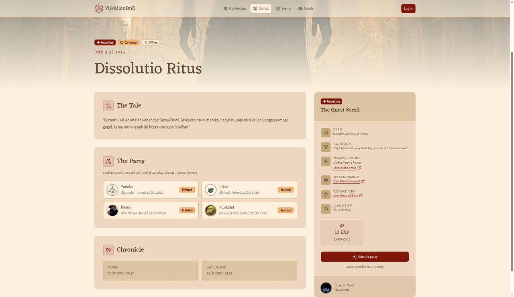
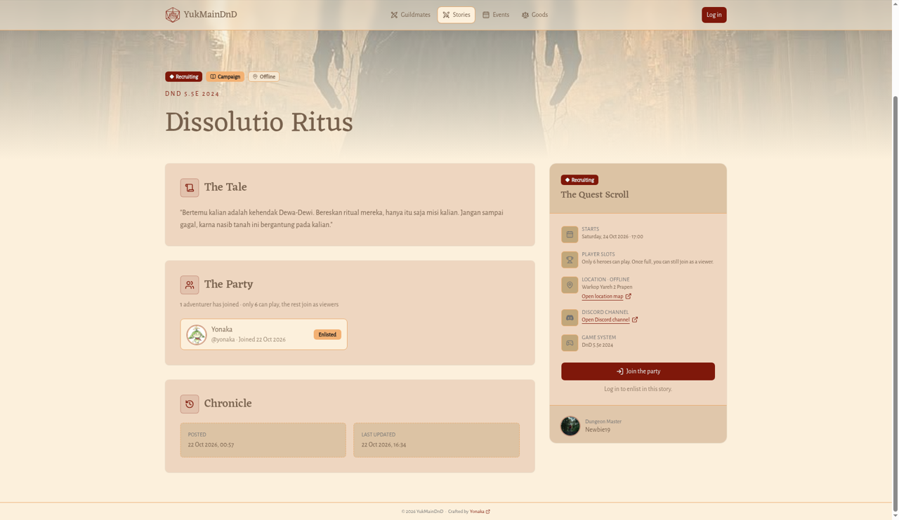
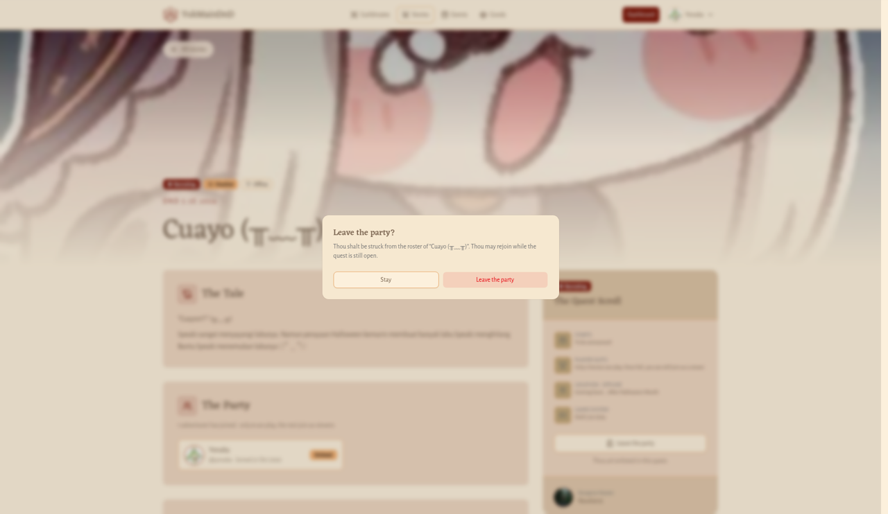

# Papan Story dan detail Story

Di guild ini, sebuah sesi permainan disebut **Story** (di menu ditulis **Stories**). Papan Story (halaman **Stories**, berlabel **THE QUEST BOARD**) adalah tempat kamu mencari meja yang masih mencari pemain.

## Papan Story

**Untuk apa:** melihat semua Story yang sedang buka atau sudah selesai.

**Siapa yang bisa membuka:** semua orang, tanpa perlu masuk.

**Cara membuka:** klik **Stories** di bilah atas, atau **See stories** / **See all stories** di Beranda.

Di bagian atas ada label **THE QUEST BOARD**, judul **Seek thy next adventure**, dan jumlah Story yang sedang tertempel, misalnya "1 story pinned to the board".

### Mencari Story

1. Ketik judul Story di kolom **Search stories by title (min. 3 characters)…**.
2. Tunggu sebentar. Hasil diperbarui otomatis setelah kamu mengetik minimal 3 huruf.

Untuk kembali ke daftar lengkap, kosongkan kolom pencarian.

### Menyaring berdasarkan jenis

Di bawah kolom pencarian ada tab **All**, **Oneshot**, dan **Campaign**. Klik salah satu; daftar langsung tersaring.

### Menyaring berdasarkan status dan lokasi

1. Klik **Filters**.
2. Di **Status**, pilih **All statuses**, **Published** (sedang buka), atau **Completed** (sudah selesai).
3. Di **Location**, pilih **Anywhere**, **Online**, atau **Offline**.
4. Klik **Apply**.

Angka kecil di tombol **Filters** menunjukkan berapa saringan yang sedang aktif. Klik **Clear** di dalam panel untuk menghapus saringan status dan lokasi.

### Membaca kartu Story

Setiap kartu menampilkan:

- label status: **Recruiting** untuk Story yang sedang buka, atau **Completed** untuk yang sudah selesai,
- sistem permainan dan judul Story (klik judul untuk membuka detail),
- jenis (**Oneshot** atau **Campaign**) dan lokasi (**Online** atau **Offline**),
- cuplikan cerita, atau **The tale is yet to be written…** kalau belum ada,
- tanggal mulai (atau **Date to be proclaimed**) dan jumlah yang sudah bergabung, misalnya "5 joined",
- jatah pemain, misalnya "Only 4 heroes can play, others join as viewers", atau **No player limit set**,
- nama **Dungeon Master** (klik untuk membuka kartu petualangnya).

### Berpindah halaman

Setiap halaman memuat 12 Story. Di bawah daftar ada tulisan seperti "Showing 1–12 of 30 stories". Klik nomor halaman atau panah kiri dan kanan untuk berpindah.

### Kalau tidak ada hasil

- Kalau pencarian atau saringanmu tidak cocok dengan Story mana pun, muncul **No stories found** dan tombol **Clear search & filters**.
- Kalau memang belum ada Story, muncul **The quest board is empty for now. Return soon, adventurer.**
- Kalau papan gagal dimuat, muncul **The scrolls could not be fetched**. Klik **Try again**.

## Detail Story

**Untuk apa:** membaca cerita lengkap sebuah Story, melihat siapa saja yang ikut, lalu bergabung atau keluar dari party.

**Siapa yang bisa membuka:** semua orang. Untuk bergabung, kamu harus masuk dulu.

**Cara membuka:** klik judul Story di papan Story, di Beranda, atau di kartu petualang seseorang.

Halaman ini berisi:

- Bagian atas: gambar Story, label status (misalnya **Recruiting**), jenis (misalnya **Oneshot**), lokasi (misalnya **Offline**), sistem permainan, dan judul. Klik **All stories** di pojok kiri atas untuk kembali ke papan Story.
- **The Quest Scroll** (ringkasan):
  - **Starts**: hari dan jam mulai, atau **To be announced**.
  - **Player slots**: misalnya "Only 4 heroes can play. Once full, you can still join as a viewer.", atau **No limit set**.
  - **Location · Online** atau **Location · Offline**: detail tempat atau tautan bermain. Kalau ada tautan peta, di bawahnya muncul **Open location map**.
  - **Discord channel** (berlogo Discord): tautan **Open Discord channel**, hanya kalau Dungeon Master menambahkannya.
  - **Feedback form**: tautan **Open feedback form** ke formulir umpan balik dari Dungeon Master (terbuka di tab baru), hanya kalau Dungeon Master menambahkannya.
  - **Game system**: kalau diisi.
  - Hadiah **Experience** (EXP) dan **Gold** (GP), kalau ada.
  - Tombol bergabung atau keluar (lihat di bawah).
  - Nama **Dungeon Master**.
- **The Tale**: cerita lengkap Story, atau **No description has been written for this story yet.**
- **The Party**: daftar petualang yang sudah bergabung, misalnya "5 adventurers have joined · only 4 can play, the rest join as viewers". Setiap orang punya label **Enlisted** (terdaftar), **Attended** (hadir), atau **Viewer** (penonton). Klik **Show more adventurers (… more)** untuk memuat lebih banyak. Kalau belum ada yang ikut, muncul **No adventurers have joined yet**.
- **Chronicle**: tanggal **Posted** (diterbitkan) dan **Last updated** (terakhir diubah).

Di ponsel, tombol bergabung tampil di bilah bawah layar.

### Bergabung dengan party

**Siapa:** pemain yang sudah masuk, untuk Story yang menerima anggota baru.

1. Buka detail Story.
2. Kalau kamu belum masuk, tombolnya bertuliskan **Join the party** dengan catatan **Log in to enlist in this story.** Klik tombol itu, masuk ke akunmu, dan kamu akan dikembalikan ke halaman Story ini.
3. Klik **Join the party**. Kamu langsung bergabung tanpa jendela konfirmasi.
4. Kalau semua jatah pemain sudah terisi, muncul jendela **The party is full**. Kamu tetap bisa ikut sebagai penonton:
   - klik **Join as viewer** untuk ikut sebagai penonton, atau
   - klik **Not now** untuk batal.

   Bicarakan dengan Dungeon Master kalau kamu ingin menjadi pemain cadangan.

**Hasilnya:** muncul pesan **Welcome to the party, adventurer!** dan namamu masuk ke daftar **The Party**. Tombolnya berganti menjadi **Leave the party**, dan catatan di bawahnya berubah menjadi **Thou art enlisted in this story.** Story ini juga muncul di halaman [My Stories](../pemain/dashboard.md#story-ku-my-stories).

> **Perlu kamu tahu:** Siapa pun boleh bergabung, termasuk Dungeon Master yang menulis Story itu. Kalau ia ikut, ia dihitung dalam jatah pemain seperti anggota lain. Jatah pemain hanya menentukan berapa orang yang akan dihadiahi saat Story selesai. Dungeon Master yang menentukan siapa yang hadir di akhir.

### Keluar dari party

1. Buka detail Story yang sudah kamu ikuti.
2. Klik **Leave the party**.
3. Jendela **Leave the party?** muncul dengan pesan "Thou shalt be struck from the roster of “(judul Story)”. Thou may rejoin while the story is still open."
4. Klik **Leave the party** untuk keluar, atau **Stay** untuk batal.

**Hasilnya:** muncul pesan **You have left the party** dan namamu hilang dari daftar. Kamu bisa bergabung lagi selama Story masih buka.

### Kapan tombol tidak muncul

Tombol bergabung dan keluar hanya muncul kalau aksinya memang tersedia untukmu saat itu. Contohnya, kalau kamu belum masuk, tombol **Join the party** hanya muncul di Story yang sedang buka (**Recruiting**), tidak di Story yang sudah **Completed**.
